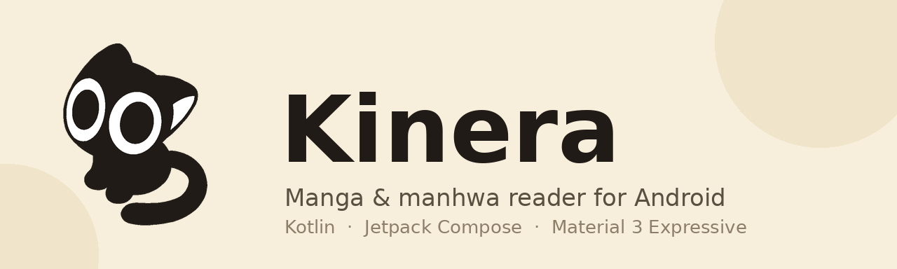

<div align="center">
  
</div>

[](https://github.com/mel0k1/Kinera/actions/workflows/ci.yml)

# Kinera

A manga and manhwa reader for Android, written in Kotlin with Jetpack Compose and Material 3 Expressive. It reads from the official [MangaDex API](https://api.mangadex.org) and keeps your library on the device. No accounts, no tracking, no bundled content.

- Android 12+ (API 31)
- Kotlin 2.4 · Compose · Material 3 Expressive
- License: [GPL-3.0](LICENSE)

[Русская версия](README.ru.md)

## Features

- **Library** — favourites with custom categories, long-press to remove
- **Explore** — popular and latest titles from MangaDex, endless scroll
- **Local sources** — import CBZ/ZIP archives through the system picker; they stay in app storage and read like any other manga
- **Offline downloads** — save chapters from the chapter list (one by one or all at once), a dedicated Downloads tab shows progress, retries and cleanup
- **Search** — debounced title search
- **Reader** — webtoon (continuous scroll) and paged modes, switchable on the fly; pinch-to-zoom and double-tap zoom in both modes; screen stays awake while you read
- **History** — automatic reading progress, resume where you stopped
- **Details** — chapter list with read markers, tags, description
- **Material You** — dynamic color from your wallpaper, or the built-in warm amber theme
- **Expressive motion** — spring-based animation scheme, wavy progress indicators, morphing favourite toggle

## Screenshots

Coming with the first release build. CI assembles a debug APK on every push, so nothing here is hand-waved — the code builds.

## Build

Requirements: Android Studio (Ladybug or newer) and JDK 17.

```bash
git clone https://github.com/mel0k1/Kinera.git
cd Kinera
./gradlew :app:assembleDebug
```

The APK lands in `app/build/outputs/apk/debug/`.

No Android Studio around? Every push to `main` runs [Android CI](https://github.com/mel0k1/Kinera/actions/workflows/ci.yml), which publishes a debug APK as a workflow artifact — grab the latest green run and install it.

Or open the folder in Android Studio and press Run.

## Architecture

A single `:app` module, split by package:

```
org.kinera.app
├── core/          domain models, UI state
├── data/
│   ├── mangadex/  Retrofit API, DTOs, MangaDex source
│   ├── localsource/ CBZ import, scanning and page extraction
│   ├── downloads/ on-disk storage for downloaded chapters
│   ├── local/     Room database (favourites, history, categories, downloads)
│   ├── settings/  DataStore preferences
│   └── repository/ catalog, library and download repositories
├── di/            Koin modules
├── worker/        WorkManager job that saves chapter pages
└── ui/
    ├── theme/     Material 3 Expressive theme and motion
    ├── components/ shared composables
    └── screens/   library, explore, search, details, reader, downloads, history, settings
```

UI is 100% Jetpack Compose. DI is Koin. Network is Retrofit + OkHttp with kotlinx.serialization. Images go through Coil with a 256 MB disk cache. Background work (chapter downloads) is WorkManager with a Koin-backed worker factory.

## Roadmap

- More catalog sources behind a common interface
- Folders of loose images as a local source
- Bookmarks inside chapters
- Beta release with signed builds in Releases

## Credits and legal

- [Kotatsu](https://github.com/KotatsuApp/Kotatsu) — inspiration and the general idea of a free, open manga reader for Android
- [MangaDex](https://mangadex.org) — catalog data comes from their public API; Kinera is not affiliated with MangaDex
- App icon and logo by [mel0k1](https://github.com/mel0k1)

Kinera does not host or provide any manga. It is a client for a public API, and everything you read belongs to its respective authors and publishers.

## License

This project is licensed under the [GNU GPL-3.0](LICENSE). If you fork it and distribute the result, the fork must stay open under the same license.
