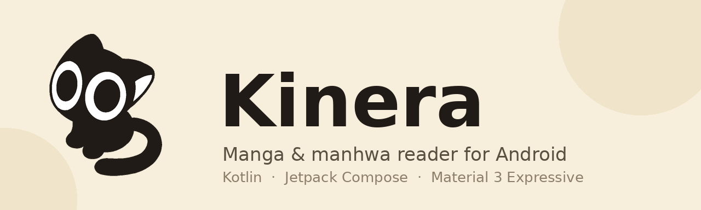

<div align="center">
  
</div>

[](https://github.com/mel0k1/Kinera/actions/workflows/ci.yml)

# Kinera

Читалка манги и маньхуа для Android на Kotlin, Jetpack Compose и Material 3 Expressive. Работает с официальным [API MangaDex](https://api.mangadex.org), библиотека хранится на устройстве. Без аккаунтов, без трекинга, без встроенного контента.

- Android 12+ (API 31)
- Kotlin 2.4 · Compose · Material 3 Expressive
- Лицензия: [GPL-3.0](LICENSE)

[English version](README.md)

## Возможности

- **Библиотека** — избранное с категориями, долгое нажатие убирает из библиотеки
- **Обзор** — популярное и свежее с MangaDex, бесконечная прокрутка
- **Локальные источники** — импорт CBZ/ZIP-архивов через системный выбор файлов; архивы живут в хранилище приложения и читаются как обычная манга
- **Офлайн-загрузки** — сохранение глав из списка (по одной или все сразу), отдельная вкладка «Загрузки» с прогрессом, повторами и удалением
- **Поиск** — поиск по названию с задержкой на ввод
- **Читалка** — режим «лента» (вертикальная прокрутка) и постраничный, переключаются на ходу; зум щипком и двойным нажатием в обоих режимах; экран не гаснет во время чтения
- **История** — автоматический прогресс чтения, возврат на последнюю страницу
- **Детали** — список глав с отметками о прочитанном, теги, описание
- **Material You** — динамические цвета из обоев или встроенная тёплая янтарная тема
- **Expressive-анимации** — пружинная схема движения, волнистые индикаторы, морфинг кнопки «в избранное»

## Скриншоты

Появятся вместе с первым релизным билдом. CI собирает debug-APK на каждый пуш, так что код точно собирается.

## Сборка

Нужны Android Studio (Ladybug или новее) и JDK 17.

```bash
git clone https://github.com/mel0k1/Kinera.git
cd Kinera
./gradlew :app:assembleDebug
```

APK окажется в `app/build/outputs/apk/debug/`.

Нет под рукой Android Studio? Каждый пуш в `main` запускает [Android CI](https://github.com/mel0k1/Kinera/actions/workflows/ci.yml), который публикует debug-APK как артефакт воркфлоу — возьмите свежий зелёный запуск и установите его.

Или откройте папку в Android Studio и нажмите Run.

## Архитектура

Один модуль `:app`, разбитый по пакетам:

```
org.kinera.app
├── core/          доменные модели, состояние UI
├── data/
│   ├── mangadex/  Retrofit API, DTO, источник MangaDex
│   ├── localsource/ импорт CBZ, сканирование и распаковка страниц
│   ├── downloads/ файловое хранилище скачанных глав
│   ├── local/     база Room (избранное, история, категории, загрузки)
│   ├── settings/  настройки на DataStore
│   └── repository/ репозитории каталога, библиотеки и загрузок
├── di/            модули Koin
├── worker/        WorkManager-задача, сохраняющая страницы глав
└── ui/
    ├── theme/     тема и анимации Material 3 Expressive
    ├── components/ общие composables
    └── screens/   библиотека, обзор, поиск, детали, читалка, загрузки, история, настройки
```

Интерфейс целиком на Jetpack Compose. DI — Koin. Сеть — Retrofit + OkHttp с kotlinx.serialization. Картинки идут через Coil с дисковым кэшем на 256 МБ. Фоновая работа (скачивание глав) — WorkManager с фабрикой воркеров на Koin.

## Планы

- Больше каталогов за общим интерфейсом
- Папки с картинками как локальный источник
- Закладки внутри глав
- Бета-релиз с подписанными сборками в Releases

## Благодарности и право

- [Kotatsu](https://github.com/KotatsuApp/Kotatsu) — вдохновение и сама идея свободной читалки для Android
- [MangaDex](https://mangadex.org) — данные каталога берутся из их публичного API; Kinera не связана с MangaDex
- Иконка приложения и логотип — [mel0k1](https://github.com/mel0k1)

Kinera не хостит и не раздаёт мангу. Это клиент публичного API, права на всё прочитанное остаются у авторов и издателей.

## Лицензия

Проект распространяется под [GNU GPL-3.0](LICENSE). Если делаете форк и распространяете его — форк обязан остаться открытым под той же лицензией.
